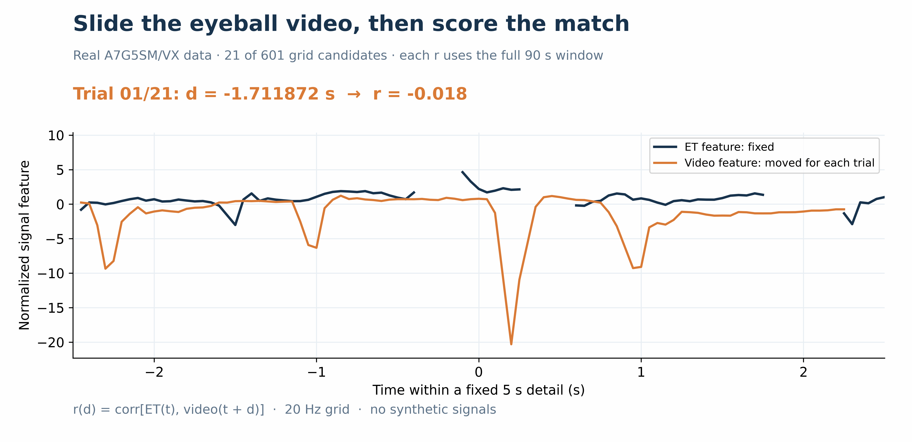
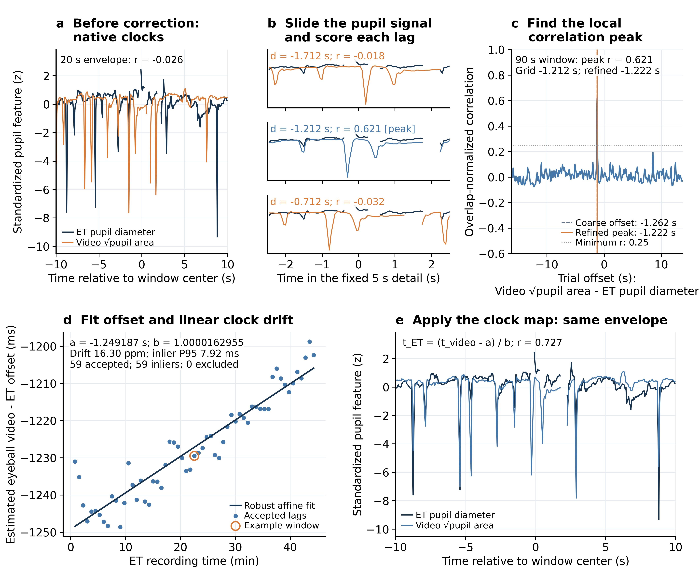

# ImBrAid processing code

Code for anonymization, preprocessing, synchronization and technical validation of the ImBrAid dataset. Original videos are not publicly released.

The dataset is available at https://zenodo.org/records/23212534

## Setup

```powershell
python -m pip install -r requirements.txt
```

Video processing `00` requires FFmpeg and ffprobe available on PATH.

Notebook `13c` also requires `mne`, `mne-icalabel`, and either `torch` or `onnxruntime`.

Set local paths in [config.json](config.json).

## Notebooks

| Notebook | Purpose | Output |
|---|---|---|
| [Anonymization](pipeline/Anonymization/run_only_once.ipynb) | Randomize IDs and shift dates | Anonymized data |
| [Eyeball 00](pipeline/Eyeball/00_eyeball_pipeline.ipynb) | Extract pupil features | Converted videos and pupil CSVs |
| [Driver 00](pipeline/DriverVideo/00_extract_driver_landmarks.ipynb) | Extract face and pose landmarks | Landmark CSVs |
| [Driver 00.5](pipeline/DriverVideo/00.5_persist_exact_driver_pts.ipynb) | Add exact video timestamps | Updated landmark CSVs |
| [01](pipeline/Sync_and_Quality/01_et_raw_lsl_alignment.ipynb) | Align ET to LSL | ET–LSL mapping |
| [02](pipeline/Sync_and_Quality/02_driver_et_raw_alignment.ipynb) | Align Driver Video to ET | Driver–ET mapping |
| [03](pipeline/Sync_and_Quality/03_eyeball_et_raw_alignment.ipynb) | Align Eyeball Video to ET | Eyeball–ET mapping |
| [04](pipeline/Sync_and_Quality/04_idun_raw_lsl_alignment.ipynb) | Align IDUN EEG to cap EEG | IDUN–LSL mapping |
| [10](pipeline/Sync_and_Quality/10_publication_export.ipynb) | Export synchronized features | Synchronized CSVs |
| [10.5](pipeline/Anonymization/10.5_move_controlled_data.ipynb) | Separate public and controlled data | Release folders |
| [11](pipeline/Sync_and_Quality/11_generate_xdf.ipynb) | Combine synchronized streams | Synchronized XDFs |
| [12a](pipeline/Sync_and_Quality/12a_sync_quality_summary.ipynb) | Summarize availability and synchronization | Summary table |
| [12b](pipeline/Sync_and_Quality/12b_sync_quality_figures.ipynb) | Visualize availability and alignment | Synchronization figures |
| [13a](pipeline/Sync_and_Quality/13a_technique_validation_sdlp_eye.ipynb) | Assess SDLP, eye measures and task accuracy | Figures for SDLP and eye-related modalities |
| [13b](pipeline/Sync_and_Quality/13b_technique_validation_in_ear_eeg.ipynb) | Assess in-ear EEG signal quality | Figures for in-ear EEG |
| [13c](pipeline/Sync_and_Quality/13c_technique_validation_cap_eeg.ipynb) | Estimate cap-EEG time–frequency power | Figures for cap-EEG |

Supporting files: [panel annotations](pipeline/Sync_and_Quality/annotations/panel_annotations.csv) and [helpers](helpers/).

**Running sequence**

1. **Anonymization:** `run_only_once`.
2. **Video preprocessing:** Eyeball `00` and Driver (`00` → `00.5`) can run in either order.
3. **Synchronization:** `01`–`04` in any order.
4. **Release preparation:** `10` → `10.5` → `11`. Place ET TSV files exported from Tobii Pro Lab in `preprocessed_data_root/ET` before running `11` to include that in the XDF.
5. **Quality and validation:** `12a`, `12b`, `13a`, `13b` and `13c` in any order.

For an existing release, start with `12a`/`12b` or `13a`–`13c`, using the supplied alignment tables and configured data paths.

## Synchronization method example

Shared signals or events are used to estimate clock offset and drift and map recordings to LSL time. For signal-based alignment, corresponding features are compared in successive time windows, and the time shift with the highest cross-correlation gives a local offset. Reliable offsets across the recording are then fitted with an affine clock mapping: its intercept accounts for the time offset, and its scale accounts for clock-rate differences. The figures below illustrate this process with Eyeball and ET pupil signals from [step 03](pipeline/Sync_and_Quality/03_eyeball_et_raw_alignment.ipynb), recording A7G5SM/VX.



Local offsets are estimated by comparing shifted pupil signals.



Accepted offsets are used to fit an affine clock mapping; pupil signals are compared before and after correction.
